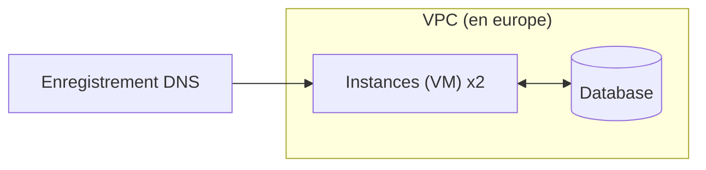

# TD 2 - Provisionner via Terraform


Infrastructure demandée :



## Structure

| Dossier | Contenu |
| --- | --- |
| [`foundation-gcp/`](./foundation-gcp) | IaC Google Cloud (`europe-west9`, Paris) |
| [`foundation-aws/`](./foundation-aws) | Même IaC chez AWS (`eu-west-3`, Paris) |

Chaque dossier contient `main.tf` (ressources), `variables.tf`, `outputs.tf` (et `terraform.tfvars` pour GCP).

## Étapes réalisées (GCP)

0. **Provider** `hashicorp/google` 6.12.0, configuré avec `var.project_id` et `var.region`.
1. **VPC** : `google_compute_network` (sans sous-réseaux automatiques) + `google_compute_subnetwork` `10.0.1.0/24` en `europe-west9`.
2. **VM** : `google_compute_instance` (Debian 12, `e2-small`) dans le sous-réseau du VPC, avec une IP publique.
3. **Base de données** : `google_sql_database_instance` MySQL 8.0 avec une **IP privée dans le même VPC** (`google_compute_global_address` + `google_service_networking_connection` pour le peering).
4. **DNS** : `google_dns_managed_zone` (`prod.kiowy.com.`) + `google_dns_record_set` type `A` `frontend.prod.kiowy.com.` vers les VM.
5. **Haute disponibilité** : meta-argument **`count = var.vm_count`** (2 par défaut) sur la VM. L'enregistrement DNS contient l'IP de **chaque** instance (`vm[*]`).

## Équivalence AWS

| Besoin | GCP | AWS |
| --- | --- | --- |
| VPC | `google_compute_network` + `google_compute_subnetwork` | `aws_vpc` + 2 `aws_subnet` (2 AZ) + IGW + route table |
| VM | `google_compute_instance` (`count`) | `aws_instance` (`count`, réparties sur 2 AZ) |
| Base de données | `google_sql_database_instance` (IP privée) | `aws_db_instance` MySQL + `aws_db_subnet_group`, non publique |
| Sécurité | réseau privé | `aws_security_group` : MySQL ouvert uniquement depuis les VM |
| DNS | `google_dns_managed_zone` + `google_dns_record_set` | `aws_route53_zone` + `aws_route53_record` |

## Lancer le projet

```bash
# GCP : la clé student.json est placée dans foundation-gcp/ (ignorée par git)
cd foundation-gcp
export GOOGLE_APPLICATION_CREDENTIALS="./student.json"
terraform init
terraform validate
terraform plan
```

```bash
# AWS : clés fournies via l'environnement
cd foundation-aws
export AWS_ACCESS_KEY_ID="<access-key-id>"
export AWS_SECRET_ACCESS_KEY="<access-key-secret>"
export AWS_REGION="eu-west-3"
terraform init
terraform validate
terraform plan
```

> [!warning]
> La clé `student.json` n'est **jamais** versionnée (`**/student.json` dans le `.gitignore`).

---

## Résultat du `terraform plan` - GCP

`terraform validate` : `Success! The configuration is valid.`

```text

Terraform used the selected providers to generate the following execution
plan. Resource actions are indicated with the following symbols:
  + create

Terraform will perform the following actions:

  # google_compute_global_address.private_ip_db will be created
  + resource "google_compute_global_address" "private_ip_db" {
      + address            = (known after apply)
      + address_type       = "INTERNAL"
      + creation_timestamp = (known after apply)
      + effective_labels   = {
          + "goog-terraform-provisioned" = "true"
        }
      + id                 = (known after apply)
      + label_fingerprint  = (known after apply)
      + name               = "private-ip-db"
      + network            = (known after apply)
      + prefix_length      = 16
      + project            = "polytech-dijon"
      + purpose            = "VPC_PEERING"
      + self_link          = (known after apply)
      + terraform_labels   = {
          + "goog-terraform-provisioned" = "true"
        }
    }

  # google_compute_instance.vm[0] will be created
  + resource "google_compute_instance" "vm" {
      + can_ip_forward       = false
      + cpu_platform         = (known after apply)
      + creation_timestamp   = (known after apply)
      + current_status       = (known after apply)
      + deletion_protection  = false
      + effective_labels     = {
          + "goog-terraform-provisioned" = "true"
        }
      + id                   = (known after apply)
      + instance_id          = (known after apply)
      + label_fingerprint    = (known after apply)
      + machine_type         = "e2-small"
      + metadata_fingerprint = (known after apply)
      + min_cpu_platform     = (known after apply)
      + name                 = "vm-pc1"
      + project              = "polytech-dijon"
      + self_link            = (known after apply)
      + tags_fingerprint     = (known after apply)
      + terraform_labels     = {
          + "goog-terraform-provisioned" = "true"
        }
      + zone                 = "europe-west9-a"

      + boot_disk {
          + auto_delete                = true
          + device_name                = (known after apply)
          + disk_encryption_key_sha256 = (known after apply)
          + kms_key_self_link          = (known after apply)
          + mode                       = "READ_WRITE"
          + source                     = (known after apply)

          + initialize_params {
              + image                  = "debian-cloud/debian-12"
              + labels                 = (known after apply)
              + provisioned_iops       = (known after apply)
              + provisioned_throughput = (known after apply)
              + resource_policies      = (known after apply)
              + size                   = (known after apply)
              + type                   = (known after apply)
            }
        }

      + confidential_instance_config (known after apply)

      + guest_accelerator (known after apply)

      + network_interface {
          + internal_ipv6_prefix_length = (known after apply)
          + ipv6_access_type            = (known after apply)
          + ipv6_address                = (known after apply)
          + name                        = (known after apply)
          + network                     = (known after apply)
          + network_ip                  = (known after apply)
          + stack_type                  = (known after apply)
          + subnetwork                  = (known after apply)
          + subnetwork_project          = (known after apply)

          + access_config {
              + nat_ip       = (known after apply)
              + network_tier = (known after apply)
            }
        }

      + reservation_affinity (known after apply)

      + scheduling (known after apply)
    }

  # google_compute_instance.vm[1] will be created
  + resource "google_compute_instance" "vm" {
      + can_ip_forward       = false
      + cpu_platform         = (known after apply)
      + creation_timestamp   = (known after apply)
      + current_status       = (known after apply)
      + deletion_protection  = false
      + effective_labels     = {
          + "goog-terraform-provisioned" = "true"
        }
      + id                   = (known after apply)
      + instance_id          = (known after apply)
      + label_fingerprint    = (known after apply)
      + machine_type         = "e2-small"
      + metadata_fingerprint = (known after apply)
      + min_cpu_platform     = (known after apply)
      + name                 = "vm-pc2"
      + project              = "polytech-dijon"
      + self_link            = (known after apply)
      + tags_fingerprint     = (known after apply)
      + terraform_labels     = {
          + "goog-terraform-provisioned" = "true"
        }
      + zone                 = "europe-west9-a"

      + boot_disk {
          + auto_delete                = true
          + device_name                = (known after apply)
          + disk_encryption_key_sha256 = (known after apply)
          + kms_key_self_link          = (known after apply)
          + mode                       = "READ_WRITE"
          + source                     = (known after apply)

          + initialize_params {
              + image                  = "debian-cloud/debian-12"
              + labels                 = (known after apply)
              + provisioned_iops       = (known after apply)
              + provisioned_throughput = (known after apply)
              + resource_policies      = (known after apply)
              + size                   = (known after apply)
              + type                   = (known after apply)
            }
        }

      + confidential_instance_config (known after apply)

      + guest_accelerator (known after apply)

      + network_interface {
          + internal_ipv6_prefix_length = (known after apply)
          + ipv6_access_type            = (known after apply)
          + ipv6_address                = (known after apply)
          + name                        = (known after apply)
          + network                     = (known after apply)
          + network_ip                  = (known after apply)
          + stack_type                  = (known after apply)
          + subnetwork                  = (known after apply)
          + subnetwork_project          = (known after apply)

          + access_config {
              + nat_ip       = (known after apply)
              + network_tier = (known after apply)
            }
        }

      + reservation_affinity (known after apply)

      + scheduling (known after apply)
    }

  # google_compute_network.vpc_1 will be created
  + resource "google_compute_network" "vpc_1" {
      + auto_create_subnetworks                   = false
      + delete_default_routes_on_create           = false
      + gateway_ipv4                              = (known after apply)
      + id                                        = (known after apply)
      + internal_ipv6_range                       = (known after apply)
      + mtu                                       = (known after apply)
      + name                                      = "vpc-1"
      + network_firewall_policy_enforcement_order = "AFTER_CLASSIC_FIREWALL"
      + numeric_id                                = (known after apply)
      + project                                   = "polytech-dijon"
      + routing_mode                              = (known after apply)
      + self_link                                 = (known after apply)
    }

  # google_compute_subnetwork.subnet_1 will be created
  + resource "google_compute_subnetwork" "subnet_1" {
      + creation_timestamp         = (known after apply)
      + external_ipv6_prefix       = (known after apply)
      + fingerprint                = (known after apply)
      + gateway_address            = (known after apply)
      + id                         = (known after apply)
      + internal_ipv6_prefix       = (known after apply)
      + ip_cidr_range              = "10.0.1.0/24"
      + ipv6_cidr_range            = (known after apply)
      + name                       = "subnet-1"
      + network                    = (known after apply)
      + private_ip_google_access   = (known after apply)
      + private_ipv6_google_access = (known after apply)
      + project                    = "polytech-dijon"
      + purpose                    = (known after apply)
      + region                     = "europe-west9"
      + self_link                  = (known after apply)
      + stack_type                 = (known after apply)

      + secondary_ip_range (known after apply)
    }

  # google_dns_managed_zone.prod will be created
  + resource "google_dns_managed_zone" "prod" {
      + creation_time    = (known after apply)
      + description      = "Managed by Terraform"
      + dns_name         = "prod.kiowy.com."
      + effective_labels = {
          + "goog-terraform-provisioned" = "true"
        }
      + force_destroy    = false
      + id               = (known after apply)
      + managed_zone_id  = (known after apply)
      + name             = "prod-zone"
      + name_servers     = (known after apply)
      + project          = "polytech-dijon"
      + terraform_labels = {
          + "goog-terraform-provisioned" = "true"
        }
      + visibility       = "public"

      + cloud_logging_config (known after apply)

      + dnssec_config (known after apply)
    }

  # google_dns_record_set.frontend will be created
  + resource "google_dns_record_set" "frontend" {
      + id           = (known after apply)
      + managed_zone = "prod-zone"
      + name         = "frontend.prod.kiowy.com."
      + project      = "polytech-dijon"
      + rrdatas      = (known after apply)
      + ttl          = 300
      + type         = "A"
    }

  # google_service_networking_connection.private_vpc_connection will be created
  + resource "google_service_networking_connection" "private_vpc_connection" {
      + id                      = (known after apply)
      + network                 = (known after apply)
      + peering                 = (known after apply)
      + reserved_peering_ranges = [
          + "private-ip-db",
        ]
      + service                 = "servicenetworking.googleapis.com"
    }

  # google_sql_database_instance.db will be created
  + resource "google_sql_database_instance" "db" {
      + available_maintenance_versions = (known after apply)
      + connection_name                = (known after apply)
      + database_version               = "MYSQL_8_0"
      + deletion_protection            = false
      + dns_name                       = (known after apply)
      + encryption_key_name            = (known after apply)
      + first_ip_address               = (known after apply)
      + id                             = (known after apply)
      + instance_type                  = (known after apply)
      + ip_address                     = (known after apply)
      + maintenance_version            = (known after apply)
      + master_instance_name           = (known after apply)
      + name                           = "vbdd-1"
      + private_ip_address             = (known after apply)
      + project                        = "polytech-dijon"
      + psc_service_attachment_link    = (known after apply)
      + public_ip_address              = (known after apply)
      + region                         = "europe-west9"
      + replica_names                  = (known after apply)
      + self_link                      = (known after apply)
      + server_ca_cert                 = (sensitive value)
      + service_account_email_address  = (known after apply)

      + replica_configuration (known after apply)

      + settings {
          + activation_policy     = "ALWAYS"
          + availability_type     = "ZONAL"
          + connector_enforcement = (known after apply)
          + disk_autoresize       = true
          + disk_autoresize_limit = 0
          + disk_size             = (known after apply)
          + disk_type             = "PD_SSD"
          + edition               = (known after apply)
          + pricing_plan          = "PER_USE"
          + tier                  = "db-f1-micro"
          + user_labels           = (known after apply)
          + version               = (known after apply)

          + backup_configuration (known after apply)

          + data_cache_config (known after apply)

          + insights_config (known after apply)

          + ip_configuration {
              + ipv4_enabled    = false
              + private_network = (known after apply)
              + server_ca_mode  = (known after apply)
              + ssl_mode        = (known after apply)
            }

          + location_preference (known after apply)
        }
    }

Plan: 9 to add, 0 to change, 0 to destroy.

Changes to Outputs:
  + db_connection_name = (known after apply)
  + frontend_fqdn      = "frontend.prod.kiowy.com."
  + vm_public_ips      = [
      + (known after apply),
      + (known after apply),
    ]

─────────────────────────────────────────────────────────────────────────────

Note: You didn't use the -out option to save this plan, so Terraform can't
guarantee to take exactly these actions if you run "terraform apply" now.
```

## Résultat du `terraform plan` - AWS

`terraform validate` : `Success! The configuration is valid.`

> [!note]
> Aucune clé AWS n'était disponible sur le poste. Le plan ci-dessous a donc été généré hors ligne (`skip_credentials_validation`, `skip_requesting_account_id`) : les ressources et leurs attributs sont ceux qui seront créés.

```text

Terraform used the selected providers to generate the following execution
plan. Resource actions are indicated with the following symbols:
  + create

Terraform will perform the following actions:

  # aws_db_instance.db will be created
  + resource "aws_db_instance" "db" {
      + address                               = (known after apply)
      + allocated_storage                     = 20
      + apply_immediately                     = false
      + arn                                   = (known after apply)
      + auto_minor_version_upgrade            = true
      + availability_zone                     = (known after apply)
      + backup_retention_period               = (known after apply)
      + backup_target                         = (known after apply)
      + backup_window                         = (known after apply)
      + ca_cert_identifier                    = (known after apply)
      + character_set_name                    = (known after apply)
      + copy_tags_to_snapshot                 = false
      + database_insights_mode                = (known after apply)
      + db_name                               = (known after apply)
      + db_subnet_group_name                  = "db-subnet-group"
      + dedicated_log_volume                  = false
      + delete_automated_backups              = true
      + domain_fqdn                           = (known after apply)
      + endpoint                              = (known after apply)
      + engine                                = "mysql"
      + engine_lifecycle_support              = (known after apply)
      + engine_version                        = "8.0"
      + engine_version_actual                 = (known after apply)
      + hosted_zone_id                        = (known after apply)
      + id                                    = (known after apply)
      + identifier                            = "vbdd-1"
      + identifier_prefix                     = (known after apply)
      + instance_class                        = "db.t3.micro"
      + iops                                  = (known after apply)
      + kms_key_id                            = (known after apply)
      + latest_restorable_time                = (known after apply)
      + license_model                         = (known after apply)
      + listener_endpoint                     = (known after apply)
      + maintenance_window                    = (known after apply)
      + master_user_secret                    = (known after apply)
      + master_user_secret_kms_key_id         = (known after apply)
      + monitoring_interval                   = 0
      + monitoring_role_arn                   = (known after apply)
      + multi_az                              = (known after apply)
      + multi_tenant                          = (known after apply)
      + nchar_character_set_name              = (known after apply)
      + network_type                          = (known after apply)
      + option_group_name                     = (known after apply)
      + parameter_group_name                  = (known after apply)
      + password                              = (sensitive value)
      + password_wo                           = (write-only attribute)
      + performance_insights_enabled          = false
      + performance_insights_kms_key_id       = (known after apply)
      + performance_insights_retention_period = (known after apply)
      + port                                  = (known after apply)
      + publicly_accessible                   = false
      + region                                = "eu-west-3"
      + replica_mode                          = (known after apply)
      + replicas                              = (known after apply)
      + resource_id                           = (known after apply)
      + skip_final_snapshot                   = true
      + snapshot_identifier                   = (known after apply)
      + status                                = (known after apply)
      + storage_throughput                    = (known after apply)
      + storage_type                          = (known after apply)
      + tags_all                              = (known after apply)
      + timezone                              = (known after apply)
      + upgrade_rollout_order                 = (known after apply)
      + username                              = "admin"
      + vpc_security_group_ids                = (known after apply)
    }

  # aws_db_subnet_group.db will be created
  + resource "aws_db_subnet_group" "db" {
      + arn                     = (known after apply)
      + description             = "Managed by Terraform"
      + id                      = (known after apply)
      + name                    = "db-subnet-group"
      + name_prefix             = (known after apply)
      + region                  = "eu-west-3"
      + subnet_ids              = (known after apply)
      + supported_network_types = (known after apply)
      + tags_all                = (known after apply)
      + vpc_id                  = (known after apply)
    }

  # aws_instance.vm[0] will be created
  + resource "aws_instance" "vm" {
      + ami                                  = "ami-0160e8d70ebc43ee1"
      + arn                                  = (known after apply)
      + associate_public_ip_address          = (known after apply)
      + availability_zone                    = (known after apply)
      + disable_api_stop                     = (known after apply)
      + disable_api_termination              = (known after apply)
      + ebs_optimized                        = (known after apply)
      + enable_primary_ipv6                  = (known after apply)
      + force_destroy                        = false
      + get_password_data                    = false
      + host_id                              = (known after apply)
      + host_resource_group_arn              = (known after apply)
      + iam_instance_profile                 = (known after apply)
      + id                                   = (known after apply)
      + instance_initiated_shutdown_behavior = (known after apply)
      + instance_lifecycle                   = (known after apply)
      + instance_state                       = (known after apply)
      + instance_type                        = "t3.micro"
      + ipv6_address_count                   = (known after apply)
      + ipv6_addresses                       = (known after apply)
      + key_name                             = (known after apply)
      + monitoring                           = (known after apply)
      + outpost_arn                          = (known after apply)
      + password_data                        = (known after apply)
      + placement_group                      = (known after apply)
      + placement_group_id                   = (known after apply)
      + placement_partition_number           = (known after apply)
      + primary_network_interface_id         = (known after apply)
      + private_dns                          = (known after apply)
      + private_ip                           = (known after apply)
      + public_dns                           = (known after apply)
      + public_ip                            = (known after apply)
      + region                               = "eu-west-3"
      + secondary_private_ips                = (known after apply)
      + security_groups                      = (known after apply)
      + source_dest_check                    = true
      + spot_instance_request_id             = (known after apply)
      + subnet_id                            = (known after apply)
      + tags                                 = {
          + "Name" = "vm-pc1"
        }
      + tags_all                             = {
          + "Name" = "vm-pc1"
        }
      + tenancy                              = (known after apply)
      + user_data_base64                     = (known after apply)
      + user_data_replace_on_change          = false
      + vpc_security_group_ids               = (known after apply)

      + capacity_reservation_specification (known after apply)

      + cpu_options (known after apply)

      + ebs_block_device (known after apply)

      + enclave_options (known after apply)

      + ephemeral_block_device (known after apply)

      + instance_market_options (known after apply)

      + maintenance_options (known after apply)

      + metadata_options (known after apply)

      + network_interface (known after apply)

      + primary_network_interface (known after apply)

      + private_dns_name_options (known after apply)

      + root_block_device (known after apply)

      + secondary_network_interface (known after apply)
    }

  # aws_instance.vm[1] will be created
  + resource "aws_instance" "vm" {
      + ami                                  = "ami-0160e8d70ebc43ee1"
      + arn                                  = (known after apply)
      + associate_public_ip_address          = (known after apply)
      + availability_zone                    = (known after apply)
      + disable_api_stop                     = (known after apply)
      + disable_api_termination              = (known after apply)
      + ebs_optimized                        = (known after apply)
      + enable_primary_ipv6                  = (known after apply)
      + force_destroy                        = false
      + get_password_data                    = false
      + host_id                              = (known after apply)
      + host_resource_group_arn              = (known after apply)
      + iam_instance_profile                 = (known after apply)
      + id                                   = (known after apply)
      + instance_initiated_shutdown_behavior = (known after apply)
      + instance_lifecycle                   = (known after apply)
      + instance_state                       = (known after apply)
      + instance_type                        = "t3.micro"
      + ipv6_address_count                   = (known after apply)
      + ipv6_addresses                       = (known after apply)
      + key_name                             = (known after apply)
      + monitoring                           = (known after apply)
      + outpost_arn                          = (known after apply)
      + password_data                        = (known after apply)
      + placement_group                      = (known after apply)
      + placement_group_id                   = (known after apply)
      + placement_partition_number           = (known after apply)
      + primary_network_interface_id         = (known after apply)
      + private_dns                          = (known after apply)
      + private_ip                           = (known after apply)
      + public_dns                           = (known after apply)
      + public_ip                            = (known after apply)
      + region                               = "eu-west-3"
      + secondary_private_ips                = (known after apply)
      + security_groups                      = (known after apply)
      + source_dest_check                    = true
      + spot_instance_request_id             = (known after apply)
      + subnet_id                            = (known after apply)
      + tags                                 = {
          + "Name" = "vm-pc2"
        }
      + tags_all                             = {
          + "Name" = "vm-pc2"
        }
      + tenancy                              = (known after apply)
      + user_data_base64                     = (known after apply)
      + user_data_replace_on_change          = false
      + vpc_security_group_ids               = (known after apply)

      + capacity_reservation_specification (known after apply)

      + cpu_options (known after apply)

      + ebs_block_device (known after apply)

      + enclave_options (known after apply)

      + ephemeral_block_device (known after apply)

      + instance_market_options (known after apply)

      + maintenance_options (known after apply)

      + metadata_options (known after apply)

      + network_interface (known after apply)

      + primary_network_interface (known after apply)

      + private_dns_name_options (known after apply)

      + root_block_device (known after apply)

      + secondary_network_interface (known after apply)
    }

  # aws_internet_gateway.igw will be created
  + resource "aws_internet_gateway" "igw" {
      + arn      = (known after apply)
      + id       = (known after apply)
      + owner_id = (known after apply)
      + region   = "eu-west-3"
      + tags_all = (known after apply)
      + vpc_id   = (known after apply)
    }

  # aws_route53_record.frontend will be created
  + resource "aws_route53_record" "frontend" {
      + allow_overwrite = (known after apply)
      + fqdn            = (known after apply)
      + id              = (known after apply)
      + name            = "frontend.prod.kiowy.com"
      + records         = (known after apply)
      + ttl             = 300
      + type            = "A"
      + zone_id         = (known after apply)
    }

  # aws_route53_zone.prod will be created
  + resource "aws_route53_zone" "prod" {
      + arn                         = (known after apply)
      + comment                     = "Managed by Terraform"
      + enable_accelerated_recovery = (known after apply)
      + force_destroy               = false
      + id                          = (known after apply)
      + name                        = "prod.kiowy.com"
      + name_servers                = (known after apply)
      + primary_name_server         = (known after apply)
      + tags_all                    = (known after apply)
      + zone_id                     = (known after apply)
    }

  # aws_route_table.public will be created
  + resource "aws_route_table" "public" {
      + arn              = (known after apply)
      + id               = (known after apply)
      + owner_id         = (known after apply)
      + propagating_vgws = (known after apply)
      + region           = "eu-west-3"
      + route            = [
          + {
              + cidr_block                 = "0.0.0.0/0"
              + gateway_id                 = (known after apply)
                # (12 unchanged attributes hidden)
            },
        ]
      + tags_all         = (known after apply)
      + vpc_id           = (known after apply)
    }

  # aws_route_table_association.public[0] will be created
  + resource "aws_route_table_association" "public" {
      + id             = (known after apply)
      + region         = "eu-west-3"
      + route_table_id = (known after apply)
      + subnet_id      = (known after apply)
    }

  # aws_route_table_association.public[1] will be created
  + resource "aws_route_table_association" "public" {
      + id             = (known after apply)
      + region         = "eu-west-3"
      + route_table_id = (known after apply)
      + subnet_id      = (known after apply)
    }

  # aws_security_group.db will be created
  + resource "aws_security_group" "db" {
      + arn                    = (known after apply)
      + description            = "Managed by Terraform"
      + egress                 = (known after apply)
      + id                     = (known after apply)
      + ingress                = [
          + {
              + cidr_blocks      = []
              + from_port        = 3306
              + ipv6_cidr_blocks = []
              + prefix_list_ids  = []
              + protocol         = "tcp"
              + security_groups  = (known after apply)
              + self             = false
              + to_port          = 3306
                # (1 unchanged attribute hidden)
            },
        ]
      + name                   = "db-sg"
      + name_prefix            = (known after apply)
      + owner_id               = (known after apply)
      + region                 = "eu-west-3"
      + revoke_rules_on_delete = false
      + tags_all               = (known after apply)
      + vpc_id                 = (known after apply)
    }

  # aws_security_group.vm will be created
  + resource "aws_security_group" "vm" {
      + arn                    = (known after apply)
      + description            = "Managed by Terraform"
      + egress                 = [
          + {
              + cidr_blocks      = [
                  + "0.0.0.0/0",
                ]
              + from_port        = 0
              + ipv6_cidr_blocks = []
              + prefix_list_ids  = []
              + protocol         = "-1"
              + security_groups  = []
              + self             = false
              + to_port          = 0
                # (1 unchanged attribute hidden)
            },
        ]
      + id                     = (known after apply)
      + ingress                = [
          + {
              + cidr_blocks      = [
                  + "0.0.0.0/0",
                ]
              + from_port        = 80
              + ipv6_cidr_blocks = []
              + prefix_list_ids  = []
              + protocol         = "tcp"
              + security_groups  = []
              + self             = false
              + to_port          = 80
                # (1 unchanged attribute hidden)
            },
        ]
      + name                   = "vm-sg"
      + name_prefix            = (known after apply)
      + owner_id               = (known after apply)
      + region                 = "eu-west-3"
      + revoke_rules_on_delete = false
      + tags_all               = (known after apply)
      + vpc_id                 = (known after apply)
    }

  # aws_subnet.subnet[0] will be created
  + resource "aws_subnet" "subnet" {
      + arn                                            = (known after apply)
      + assign_ipv6_address_on_creation                = false
      + availability_zone                              = "eu-west-3a"
      + availability_zone_id                           = (known after apply)
      + cidr_block                                     = "10.0.1.0/24"
      + enable_dns64                                   = false
      + enable_resource_name_dns_a_record_on_launch    = false
      + enable_resource_name_dns_aaaa_record_on_launch = false
      + id                                             = (known after apply)
      + ipv6_cidr_block                                = (known after apply)
      + ipv6_cidr_block_association_id                 = (known after apply)
      + ipv6_native                                    = false
      + map_public_ip_on_launch                        = true
      + network_firewall_connectivity_type             = (known after apply)
      + owner_id                                       = (known after apply)
      + private_dns_hostname_type_on_launch            = (known after apply)
      + region                                         = "eu-west-3"
      + tags                                           = {
          + "Name" = "subnet-1"
        }
      + tags_all                                       = {
          + "Name" = "subnet-1"
        }
      + vpc_id                                         = (known after apply)
    }

  # aws_subnet.subnet[1] will be created
  + resource "aws_subnet" "subnet" {
      + arn                                            = (known after apply)
      + assign_ipv6_address_on_creation                = false
      + availability_zone                              = "eu-west-3b"
      + availability_zone_id                           = (known after apply)
      + cidr_block                                     = "10.0.2.0/24"
      + enable_dns64                                   = false
      + enable_resource_name_dns_a_record_on_launch    = false
      + enable_resource_name_dns_aaaa_record_on_launch = false
      + id                                             = (known after apply)
      + ipv6_cidr_block                                = (known after apply)
      + ipv6_cidr_block_association_id                 = (known after apply)
      + ipv6_native                                    = false
      + map_public_ip_on_launch                        = true
      + network_firewall_connectivity_type             = (known after apply)
      + owner_id                                       = (known after apply)
      + private_dns_hostname_type_on_launch            = (known after apply)
      + region                                         = "eu-west-3"
      + tags                                           = {
          + "Name" = "subnet-2"
        }
      + tags_all                                       = {
          + "Name" = "subnet-2"
        }
      + vpc_id                                         = (known after apply)
    }

  # aws_vpc.vpc_1 will be created
  + resource "aws_vpc" "vpc_1" {
      + arn                                  = (known after apply)
      + cidr_block                           = "10.0.0.0/16"
      + default_network_acl_id               = (known after apply)
      + default_route_table_id               = (known after apply)
      + default_security_group_id            = (known after apply)
      + dhcp_options_id                      = (known after apply)
      + enable_dns_hostnames                 = true
      + enable_dns_support                   = true
      + enable_network_address_usage_metrics = (known after apply)
      + id                                   = (known after apply)
      + instance_tenancy                     = "default"
      + ipv6_association_id                  = (known after apply)
      + ipv6_cidr_block                      = (known after apply)
      + ipv6_cidr_block_network_border_group = (known after apply)
      + main_route_table_id                  = (known after apply)
      + network_firewall_association         = (known after apply)
      + owner_id                             = (known after apply)
      + region                               = "eu-west-3"
      + tags                                 = {
          + "Name" = "vpc-1"
        }
      + tags_all                             = {
          + "Name" = "vpc-1"
        }
    }

Plan: 15 to add, 0 to change, 0 to destroy.

Changes to Outputs:
  + db_endpoint   = (known after apply)
  + frontend_fqdn = (known after apply)
  + vm_public_ips = [
      + (known after apply),
      + (known after apply),
    ]

─────────────────────────────────────────────────────────────────────────────

Note: You didn't use the -out option to save this plan, so Terraform can't
guarantee to take exactly these actions if you run "terraform apply" now.
```
